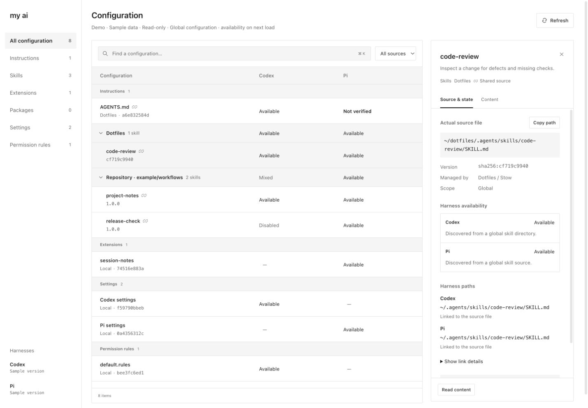

# My AI

A small, read-only local dashboard for discovering Codex and Pi configuration. Compare skills, instructions, settings, versions, and file links in one browser view.



## Try it

Requires Node.js 24 or later. Clone or download this repository, then run:

```sh
npm ci
npm run demo
```

Demo mode creates synthetic configuration in a temporary directory and ignores your real home and harness paths. The interface labels the data as a demo. Stop the server with Ctrl+C to remove the temporary files.

To inspect your own configuration:

```sh
npm start
```

Open [My AI](http://127.0.0.1:4317/) in your browser. macOS opens it automatically. Linux needs manual opening; Windows support is not verified. The server listens only on `127.0.0.1`. Stop it with Ctrl+C.

No account, API key, database, or cloud service is required. Dotfiles and GNU Stow are optional. Standard harness directories are discovered by default.

## What it shows

- Global Codex and Pi instructions, skills, selected settings, Codex permission rules, and Pi extensions/packages.
- Harness CLI versions, declared resource versions, and file fingerprints.
- Physical source files, harness paths, symlink chains, missing files, disabled resources, and instruction overrides.
- Skills grouped by plugin, package, or recorded repository origin. Search expands matching groups.
- Source content with text selection and copy buttons.

The URL preserves the category, source filter, search, selected item, and inspector tab. Refresh and browser Back/Forward restore the view. Expanded skill groups persist in the tab's session storage. Selected-item links can be specific to a machine; missing items close the inspector and keep the filters.

## Configure paths

| Variable              | Default                       |
| --------------------- | ----------------------------- |
| `MYAI_HOME`           | Current user's home directory |
| `CODEX_HOME`          | `~/.codex`                    |
| `PI_CODING_AGENT_DIR` | `~/.pi/agent`                 |
| `MYAI_DOTFILES`       | Unset; optional               |
| `MYAI_PORT`           | `4317`                        |

To include a dotfiles repository:

```sh
MYAI_DOTFILES=/path/to/dotfiles npm start
```

This enables the Dotfiles label and discovery of expected files that have not been linked. Existing symlinks are followed even without a dotfiles path. The expected layout mirrors paths under the home directory; other Stow package layouts are not inferred.

To use a different port without opening a browser:

```sh
npm run build
MYAI_PORT=4320 node src/server.ts --no-open
```

## Scope and privacy

The application does not edit settings, repair links, install packages, or execute extensions. Requests are read-only. Normal mode runs installed `codex --version` and `pi --version` to detect versions; demo mode uses sample version labels.

`Available` means a global resource should be discoverable on the next load. It does not prove a running session has loaded it. Project settings, trust, launch arguments, and policies can change availability.

Cached Codex plugin versions are not proof of active versions. Plugin skills without an explicit enabled flag are marked `Not verified`; app plugin state is not checked. Duplicate skill names from separate files also remain unverified. Remote/git Pi package resolution, Pi built-in extensions, MCP connection health, T3 Code, and installation/updates are outside the current scope.

Repository groups use recorded GitHub origins from `~/.agents/.skill-lock.json`. Files are matched by resolved installed path, without name-prefix guesses. The install record does not prove current file contents still match the repository.

Settings previews show selected fields and MCP server names rather than raw MCP configuration. Auth files are not inventoried. Other source previews show local file content, which can contain private information. Use demo mode for public screenshots and remove private details from bug reports. There is no telemetry or external data upload in the application.

## Development

```sh
npm run dev
npm run check
npm run build
npm test
```

The dev command rebuilds and restarts on source changes. Reload the browser after frontend changes. Tests use disposable fixtures and a fixture-only local server. GitHub CI runs build, type checks, and tests on Linux and macOS.

The stack is Node's HTTP server, plain TypeScript, esbuild, and CSS. Runtime dependencies parse TOML/YAML and match glob patterns. Discovery is in `src/adapters.ts`, file inspection in `src/files.ts`, detail reads in `src/discovery.ts`, and the local API in `src/server.ts`. The UI is in `src/client/`.

See [CONTRIBUTING.md](CONTRIBUTING.md) for sample mode, development rules, and pull requests.

## License

[MIT](LICENSE).
